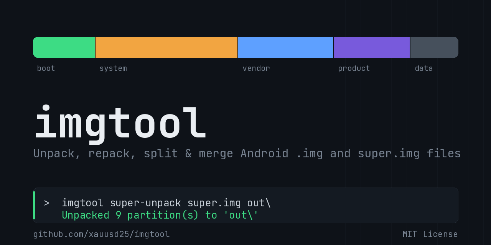

<div align="center">



[](LICENSE)


**A dependency-free, cross-platform toolkit for Android `.img` and `super.img` files.**

by @XAU_USD_25

</div>

---

`imgtool` unpacks, repacks, splits and merges the image files used in
Android ROM/firmware work — pure Python, no external packages required.

| Command | What it does |
|---|---|
| `img-unpack` | Sparse image → raw (flat) image |
| `img-repack` | Raw image → sparse image |
| `super-list` | List the logical partitions inside a `super.img` |
| `super-unpack` | Extract every partition (`system`, `vendor`, `product`, ...) from a `super.img` |
| `super-repack` | Write replacement partition images back into a copy of `super.img` |
| `super-split` | Split a large image into fixed-size numbered parts |
| `super-merge` | Merge split parts back into a single file, byte-for-byte |
| `payload-list` | List the partitions inside an OTA `payload.bin` |
| `payload-extract` | Extract partitions from a `payload.bin` |
| `payload-create` | Build a `payload.bin` from a folder of partition images |

## Requirements

- **Windows 10/11**, **Linux**, or **macOS**
- [Python 3.8+](https://www.python.org/downloads/) — on Windows, check
  **"Add python.exe to PATH"** during setup; on Linux it's usually
  preinstalled or a package away (`sudo apt install python3`, etc.). No
  `pip install` needed anywhere — everything here is pure standard library.

## Getting started

Download and extract this repo anywhere, then:

**Windows** — double-click **`imgtool.bat`** for an interactive menu.

**Linux / macOS** — run the menu script:

```sh
chmod +x imgtool.sh   # first time only
./imgtool.sh
```

Or skip the menu and use the CLI directly on any platform (`python` on
Windows, `python3` on Linux/macOS):

```sh
python -m imgtool img-unpack   sparse.img raw.img
python -m imgtool img-repack   raw.img sparse.img [block_size=4096]
python -m imgtool super-list   super.img
python -m imgtool super-unpack super.img out_folder
python -m imgtool super-repack super.img partition_folder new_super.img
python -m imgtool super-split  super.img out_folder [chunk_size_mb=1024]
python -m imgtool super-merge  super.img.000 merged_super.img
python -m imgtool payload-list    payload.bin
python -m imgtool payload-extract payload.bin out_folder [system,vendor,...]
python -m imgtool payload-create  partition_folder new_payload.bin
```

Run these from inside the extracted folder (the one containing the
`imgtool/` package, `imgtool.bat` and `imgtool.sh`).

## How each command works

**`img-unpack` / `img-repack`** implement the standard Android **sparse
image** format (the same one `img2simg` / `simg2img` use). Unpacking
expands a sparse image to its full raw size; repacking turns runs of
zero blocks back into holes so the result stays compact.

**`super-unpack`** parses the `super.img` partition table — the "liblp"
metadata Android uses for dynamic partitions — and writes each logical
partition out as its own `<name>.img`, plus a `partitions.txt` summary.
A sparse `super.img` is converted to raw automatically first.

**`super-repack`** copies your original `super.img`, then, for every file
in your partition folder whose name matches a partition in the table
(e.g. `system.img`), writes its bytes into that partition's exact
original location(s) inside the copy. Only partition *data* is touched —
never the partition table — so a replacement file must be the same size
or smaller than the space already reserved for it; anything larger is
skipped and reported rather than silently corrupting the image.

> `super-repack` expects a **raw** (non-sparse) `super.img`. If yours is
> sparse, run `img-unpack` on it first.

**`super-split` / `super-merge`** do plain byte-range splitting — `split`
cuts a file into `name.000`, `name.001`, ... parts of a chosen size
(default 1024MB); `merge` concatenates them back exactly. Point `merge`
at any one part (or the folder) and it finds and orders the rest.

**`payload-list` / `payload-extract`** read `payload.bin`, the file
inside Android OTA packages that carries every partition (built on
Google's update_engine format). `list` shows each partition's declared
size and whether its operations are extractable; `extract` decompresses
and writes out each `<name>.img`, optionally limited to a comma-separated
list of partition names. This only handles **full** OTA payloads
(`REPLACE` / `REPLACE_BZ` / `REPLACE_XZ` / `ZERO` operations), which is
what the vast majority of full OTA zips use. **Delta/incremental**
payloads (`SOURCE_COPY`, `*_BSDIFF`, `PUFFDIFF`, ...) need the matching
previous-build partition to apply against and are reported as skipped
rather than guessed at.

**`payload-create`** packs every `<name>.img` in a folder into an
unsigned, "full" `payload.bin` (each partition as one `REPLACE_XZ`
operation). This is for tools that read `payload.bin` directly (e.g.
`fastboot update`, third-party flashers, payload dumpers) — it is **not**
signed the way a vendor's genuine OTA is, so a stock recovery's OTA
installer will not accept it.

## Limitations

This is a from-scratch, offline re-implementation of Android's sparse
image and liblp formats, built for the common case of a single
block-device `super.img` (the normal layout on phones). It's aimed at
hobbyist ROM/firmware tinkering, not a drop-in replacement for AOSP's
`lpunpack`/`lpmake`. Always keep a backup of your original images, and
sanity-check partition sizes after unpacking/repacking (e.g. that an
ext4 partition still starts with the `0xEF53` magic) before trusting the
result on a real device.

## License

[MIT](LICENSE) © 2026 [xauusd25](https://github.com/xauusd25)
